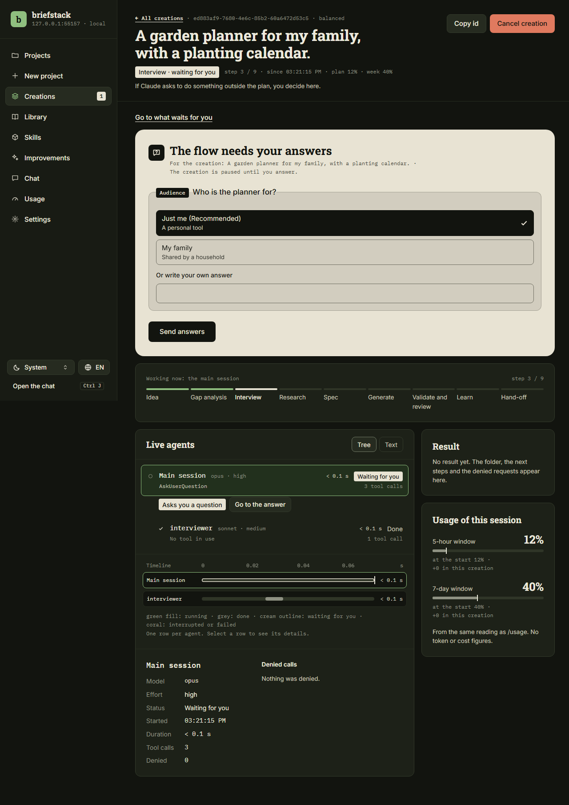

# briefstack

briefstack turns a rough idea into a ready-to-use Claude project, and gets
better at it with every project it creates.

You describe the idea in a local web app. A team of five agents, running in
**your own Claude Code**, asks you a short interview, looks things up when
needed, and writes a spec you approve. Then it prepares the project folder,
validates it and reviews it: a folder to open in Claude Code (brief,
`CLAUDE.md`, skills, agents) or one to set up in the Claude app. What it
learns about how you work goes into a personal library on your machine, so
the next interview asks less.



> briefstack is an independent project. It runs Claude Code, but it is not
> made by, affiliated with or endorsed by Anthropic.

## What it does

- **Creations** from an idea: interview, optional research, spec approval,
  generation, validation and review, with a live panel of the agents and
  every permission request shown to you. Two targets: `claude-code` (a
  folder you open with `claude`) and `claude-app` (a folder with the
  instructions to paste into a project in the Claude app).
- **A personal library** in plain Markdown (Obsidian-compatible), kept as a
  git repository: your profile, one note per project, session logs and
  lessons. You can read and edit it from the web.
- **A chat** about your projects, library, creations and usage. Every
  change it proposes waits for you to confirm it.
- **Improvements**: briefstack can propose changes to its own agents and
  templates. Each proposal is prepared apart, checked and tested, and
  nothing changes until you approve it.
- **A skills library**: add third-party skills from a public GitHub link.
  They are fetched into quarantine, reviewed (never run), and only the ones
  you approve can be proposed for new projects.
- **Tasks** in your `claude-code` projects: describe a piece of work on the
  project page or in the chat, and a Claude Code session does it in a
  separate copy of the project (a git worktree on a branch of its own),
  with the same live panel. Every shell command and web request it wants to
  run asks you first, showing the exact command. When it is done, you
  review the diff and, if you want, press "Run the checks" to run the
  checks you declared for the project on it; then approve it (one commit on
  the project's branch, never pushed), ask for changes, or discard it. Any
  applied task can be reverted from the web.

## Requirements

- **Node.js 24** or later, and npm.
- **Claude Code**, installed and working on its own: run `claude` once in a
  terminal and sign in. See [Set up Claude
  Code](https://code.claude.com/docs/en/setup). briefstack uses the
  `claude` it finds on `PATH` or in `~/.local/bin`; on Windows it must be
  the native `claude.exe` (not an npm `claude.cmd` shim).
- **git**, recommended: the library and the improvements use it. Tasks
  need git 2.38 or later.
- **A current browser** for the web app: Chrome or Edge 123, Firefox 121,
  Safari 17.5 or later.
- **Operating systems:** Windows (native), macOS and Linux. The CI runs on
  Linux, Windows and macOS on every push.

## Install

```sh
git clone https://github.com/danimoreno73/Briefstack.git
cd Briefstack
npm install        # also builds the CLI and the web app
```

There is no npm package; run briefstack from the clone with `npx
briefstack` (or `node dist/cli.js`).

## Quick start

```sh
npx briefstack init    # creates the library and the projects folder
npx briefstack web     # starts the web app on 127.0.0.1
```

`briefstack web` prints an address like
`http://127.0.0.1:4870/#token=…`. Open it, including the part after `#`:
that token is what lets your browser in. Then go to **New project**,
describe your idea and answer the questions.

When it starts, `briefstack web` also says how your Claude Code signs in,
and what to do if it is missing, too old or not signed in. Settings shows
the same, with a **Check again** button. Use `--port 0` if port 4870 is
taken.

You can also run the flow without the web app: open Claude Code in the
clone (`claude`) and type `/new-project <your idea>`.

## How authentication works, and what it costs

briefstack has no account and no sign-in of its own. It runs your
unmodified Claude Code, which signs in the way you set it up:

- **Your Claude plan** (Pro, Max, Team or Enterprise), after `claude` and
  `/login`. Creations, the chat and improvements use your plan's limits;
  the creation panel shows the 5-hour and weekly usage, and briefstack
  warns before starting when they are high (thresholds in Settings). Per
  Anthropic's article [Use the Claude Agent SDK with your Claude
  plan](https://support.claude.com/articles/15036540), usage from the
  Agent SDK and from third-party apps draws from your subscription limits.
- **Your own API key**: set `ANTHROPIC_API_KEY` (or `ANTHROPIC_AUTH_TOKEN`
  for a gateway) in the terminal that starts `briefstack web`. Usage is
  billed per request to that key. There are no plan limits, so the
  plan-usage meters are not shown.
- **A cloud provider** (Amazon Bedrock, Google Cloud's Agent Platform,
  Microsoft Foundry): set its variables (`CLAUDE_CODE_USE_BEDROCK` and the
  rest) in that terminal. Usage is billed by the provider.

briefstack never shows a login, never reads, stores or forwards your
password, token or key, and never writes them to a file or a log. Your
sessions get the environment of the terminal that started `briefstack
web`. Settings in `~/.claude/settings.json` (such as an `env` block or an
`apiKeyHelper`) are not loaded into briefstack's sessions: set what you
need as environment variables instead.

What a creation costs depends on the idea and on the usage profile. A
creation runs several agents and usually takes about ten minutes, longer
when it researches or asks many questions.

## Usage profiles

A usage profile decides which model and effort each agent uses: **Saver**,
**Balanced** (the default) or **Max**. Choose one on the Usage page or
with `npx briefstack usage set <profile>` (`saver`, `balanced`, `max`).
Saver uses Haiku and Sonnet at low effort with one review round and
research only when required; Balanced mixes Haiku, Sonnet and Opus with two
review rounds; Max uses Opus at high effort with three.
Each profile also has a `chat` entry for the chat and a `work` entry for
tasks: Sonnet at low effort in Saver, Sonnet at medium effort in Balanced,
Opus at high effort in Max.
Profiles rewrite the `model` and `effort` fields of `.claude/agents/*.md`;
do not commit those changes (`briefstack usage show` warns when they
differ from the repository).

**Upgrading to tasks:** your own presets in `usage-profiles.json` must now
have a `work` entry (`{ "model": …, "effort": … }`), like `chat`. A preset
file without it no longer loads, and the error names the missing field.
briefstack does not fill one in, so a model you never chose does not run
in your projects.

## Where your data lives

- **`BRIEFSTACK_HOME`**, by default `~/.briefstack`: `config.json`, the
  personal library (`library/`, a git repository), session records
  (`sessions/`), the chat, improvement proposals, the skills library and
  tasks (`tasks/`, each with its worktree until it is applied or
  discarded). Set the variable to keep it somewhere else.
- **The projects folder**, by default `~/briefstack-projects`: where new
  projects are created. Change it in Settings.

`npx briefstack paths` prints every folder in use. Nothing is uploaded
anywhere except what Claude Code itself sends to Claude.

**Moving a folder:** stop `briefstack web`, move the folder, and if it was
the briefstack home, point `BRIEFSTACK_HOME` to its new place. Then run
`npx briefstack paths rewrite --from <old folder> --to <new folder>`: it
lists every file and path it would change (the config, each project's
path in its note, the tasks, the folders Claude Code may write to) and
writes them only with `--apply`, the notes in one library commit. Run it
once for each folder you moved. Finish or discard open tasks and
improvements before you move anything.

## Security model, in short

- **Local only.** The web server listens on 127.0.0.1. Every API call
  needs the token from the address it printed, and checks the host and the
  origin. A restart issues a new token.
- **A guard on every session.** Agents may write only inside the projects
  folder, the creation's session folder and folders you grant for one
  creation. Unexpected requests are asked to you (or denied, in unattended
  mode) and recorded.
- **Confirmations.** The chat never changes anything by itself: each
  action is a card you confirm. Improvements are applied only after you
  approve them, as one commit you can revert.
- **Skills in quarantine.** A skill from GitHub is pinned to a commit,
  size-capped, reviewed by static checks and a short model review, and
  never executed by briefstack. Only approved skills reach a project, as
  copied files checked against their hashes.
- **Tasks work apart and ask.** A task's session reads and writes only
  inside its own copy of the project, never `.git`, settings or hook
  files. It loads the project's `CLAUDE.md`, agents and skills, but never
  its hooks or its `.claude/settings.json`, and the project's permission
  settings can only restrict it. Every shell command and web request it
  has not been allowed in that task opens a dialog with the exact command;
  you allow it once, allow that exact command for the rest of the task, or
  deny it. Nothing is remembered after the task. A command with a part
  that looks like a secret is hidden, so it can only be denied. Text in
  the project (its files, `CLAUDE.md`, command output) may hold injected
  instructions: the guard, the dialogs, the server's checks of the diff
  and your own review of the diff are what stop them. Nothing reaches your
  branch until you approve the diff.

See [SECURITY.md](SECURITY.md) to report a vulnerability.

## Limitations

- The guard is a set of checks on Claude Code's tool calls, not an
  operating-system sandbox. On native Windows Claude Code has no sandbox
  for shell commands.
- **Tasks run code from your project on your machine.** Allowing a shell
  command runs it as you, with your files and your network; what it runs
  can include files the session just changed (a test script, say). Read
  each command before you allow it. The project's own git hooks run for a
  `git` command you allow (the dialog says so); briefstack's own git never
  runs them.
- **Declared checks run only when you ask.** Nothing runs them when a
  round ends. On the task's page, after reading the diff, you press "Run
  the checks" and confirm a dialog that names the exact commands; the
  server then runs the commands you confirmed for the project, in the
  task's copy, on the change the page shows. They run project code,
  including what the session changed, as you, with network proxies pointed
  nowhere (a program can ignore them, so no network is not guaranteed) and
  a 10-minute limit each. You can approve without running them. Declare
  and run only commands you would run on the task's changes yourself.
- A task's copy has no `node_modules` or other ignored files: a check that
  needs dependencies must install them (`npm ci --offline` works from
  npm's cache), or the session can ask to run the install.
- Task commits are not signed, even if your git config signs commits, and
  briefstack never pushes. Only `claude-code` projects created by
  briefstack, one task per project at a time; tasks and creations share
  the active-sessions limit.
- A creation uses your plan or key like any Claude Code session; several
  at once add up.
- A creation from the terminal and one from the web app must not use the
  same project folder. The web app treats the folder of a terminal creation
  in progress as taken; the terminal flow does not check the web app's.
- The skill review is heuristic: it can miss code that is split, built at
  run time or encoded. Read every script before approving a skill.
- Public GitHub repositories only, for skills. No automatic updates.
- The web app is for one person on one machine. The interface is in
  English and Spanish.
- `claude-app` projects need a few manual steps in the Claude app; the
  project's `NEXT_STEPS.md` lists them.

## Development

```sh
npm run build            # type-check and build everything
npm test                 # unit tests (vitest)
npm run test:e2e         # end-to-end tests (Playwright, over fake runners)
npm run lint             # lint
npm run briefstack -- <command>   # run the CLI from source
```

See [CONTRIBUTING.md](CONTRIBUTING.md). The briefs and plans of each phase
are in [`docs/history/`](docs/history/), the decisions behind them in
[`docs/decisions.md`](docs/decisions.md) and open ideas in
[`docs/IDEAS.md`](docs/IDEAS.md).

## License

[MIT](LICENSE).
