# Before and after the UI pass

Six screens as they were at tag `ui-start` (U0) and as they are at the end
of U4, taken with the same script (`tests/screenshots/audit.shots.ts`) over
the fake runners. The temp folder of each run is shown as `<tmp>`. Desktop
pictures are scaled to three quarters of 1280 px; each file is a JPEG of at
most 150 KB. The full U0 set is in `docs/design/shots/u0/`; the full final
set is not committed (`screenshots/u4/final/`, git-ignored).

Finding numbers refer to [audit.md](audit.md).

## 1. A creation waiting for an answer (1280, light)

What the flow waits for now opens the page in a tinted block with the
section's title; the creation is named by its idea, with Cancel beside it;
the panel says each fact once and plan usage moved to the side (H3, M9,
M15, M19). Short durations read `0.4 s` instead of `0 s` (L10), and the
menu shows the running count as a figure (L3).

| Before | After |
| --- | --- |
| 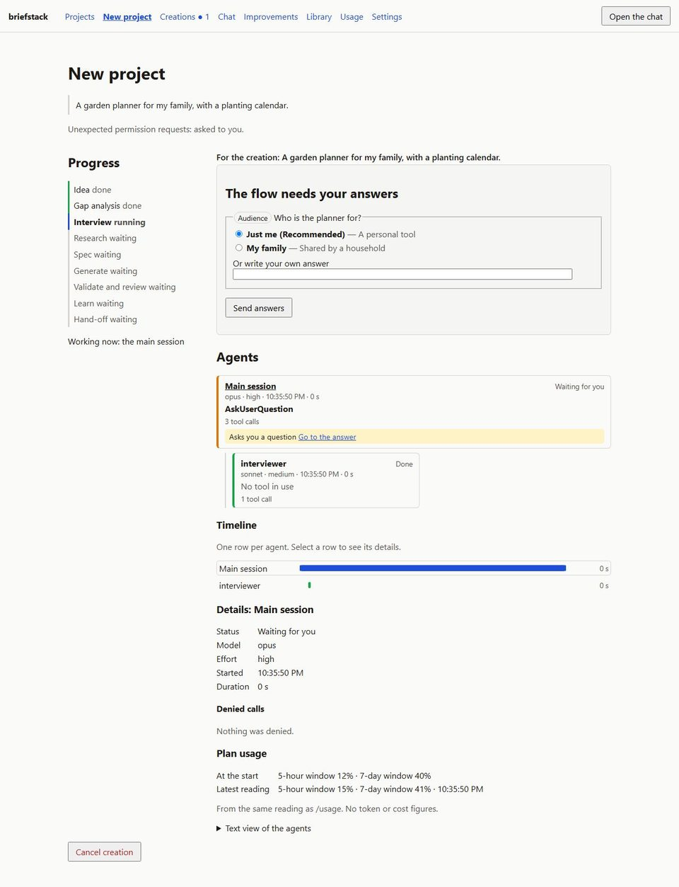 | 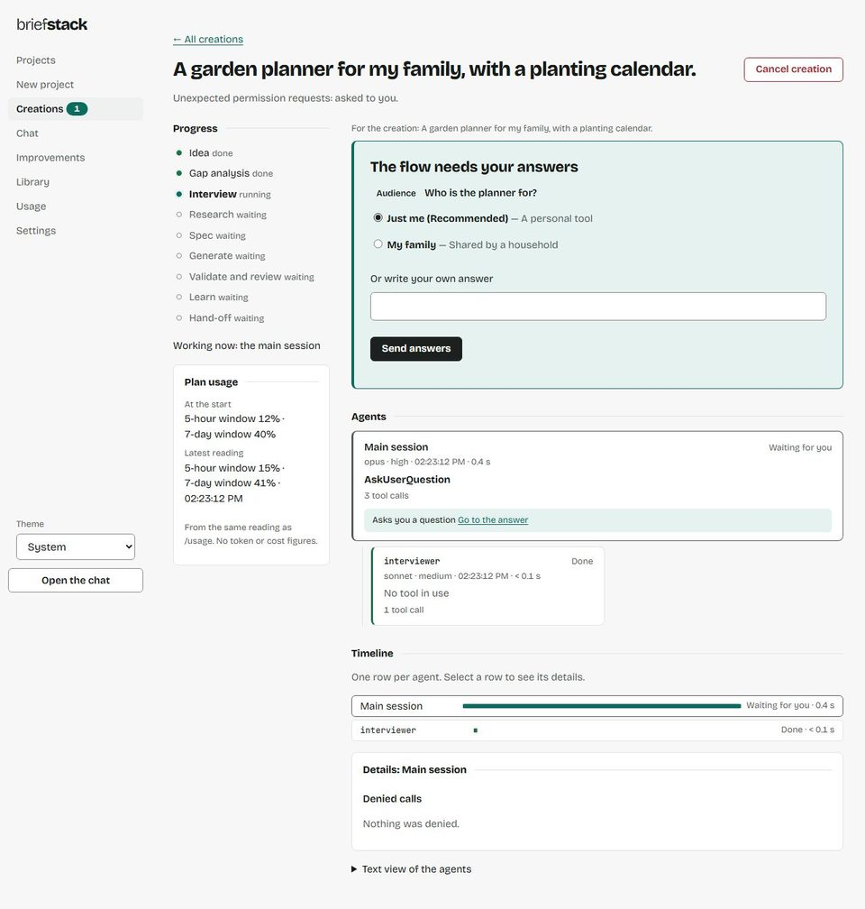 |

## 2. An improvement proposal with a safety notice (1280, dark)

The added lines are readable in dark (H1). The page reads in the order of a
decision: the request, the changes, the checks, then "Your decision" with
Approve, and the notice points down to the changes (H4, M17).

| Before | After |
| --- | --- |
| 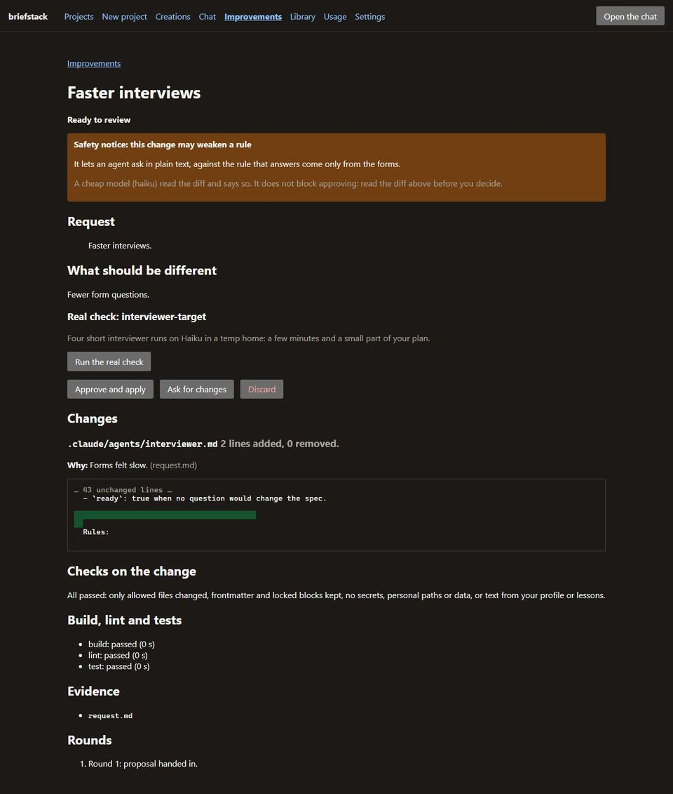 | 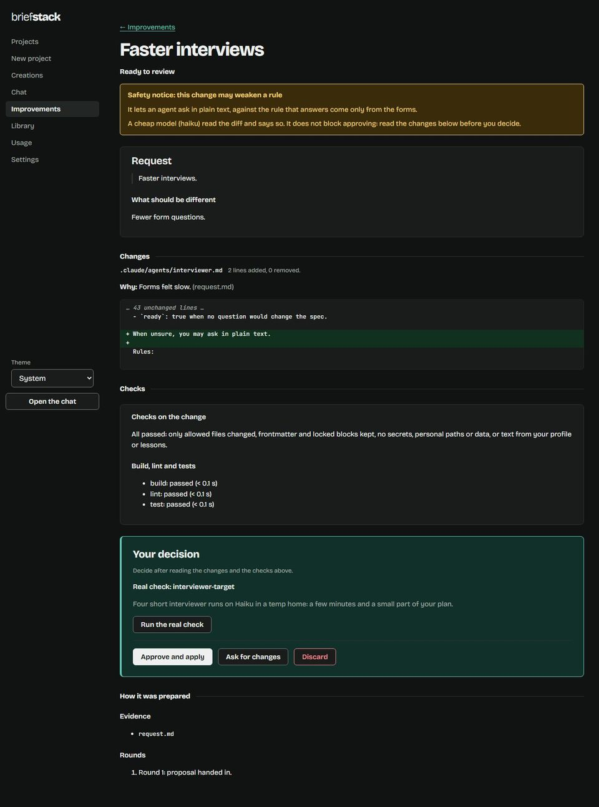 |

## 3. Projects on a phone (390, light)

The menu is one row instead of three (H6); the table becomes one block per
project instead of scrolling sideways (M7); unfinished creations are named
by their idea, with the session id last (M8).

| Before | After |
| --- | --- |
| 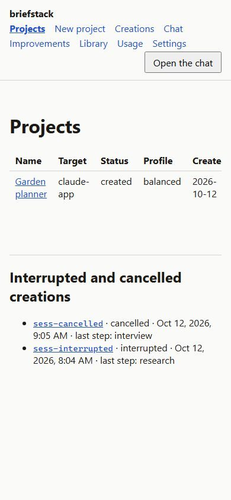 | 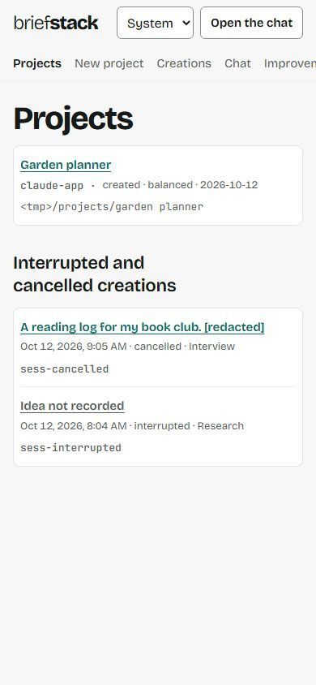 |

## 4. A chat confirmation card (1280, dark)

The card stands out and its diff is readable (H1, M11); Confirm is the one
primary and Decline is no longer red; the line under it says it waits for
you (M10); messages from you sit on a sheet (L9); the message box has its
label above it (M5).

| Before | After |
| --- | --- |
| 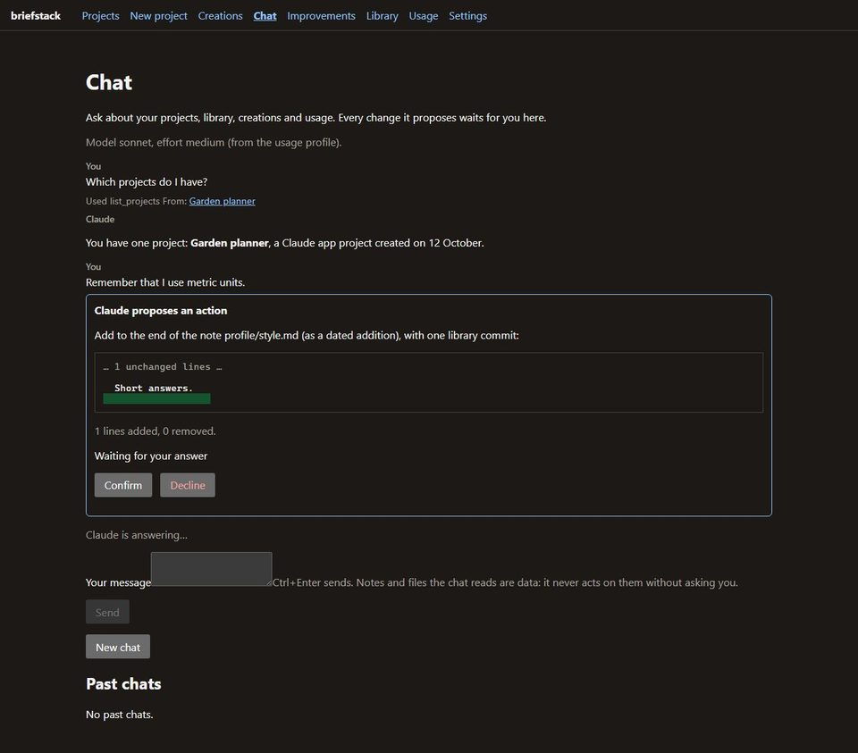 | 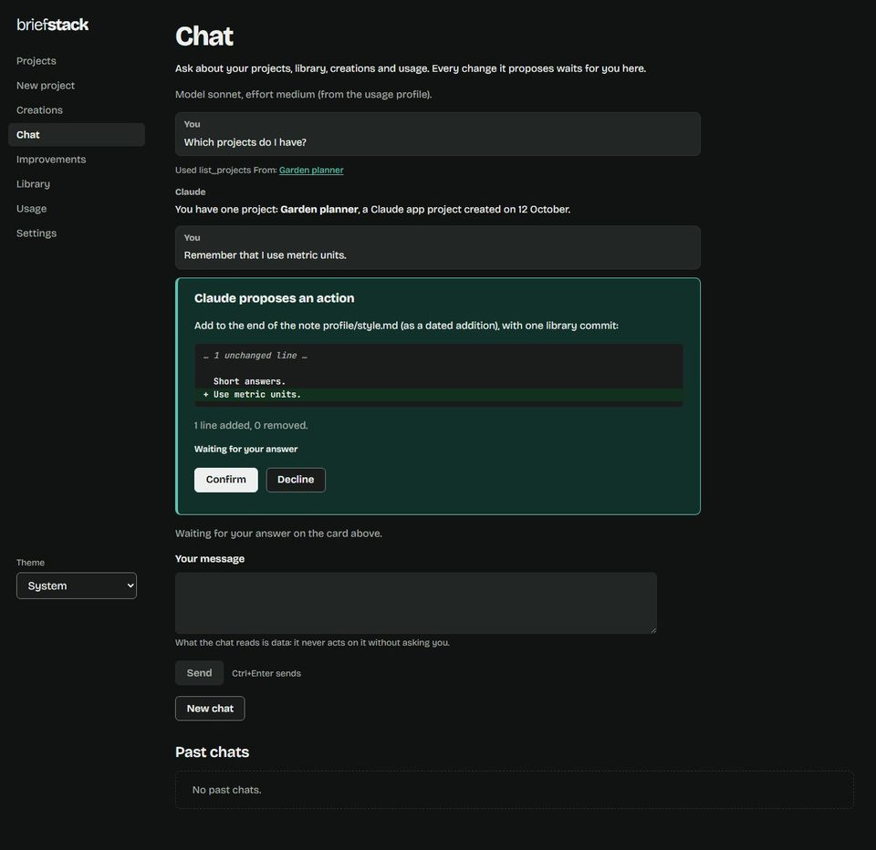 |

## 5. An old tab after a restart (1280, light)

Instead of "Something went wrong (web.rejected.token)" and a retry that can
never work, the page says briefstack was restarted and to open the new link
from the terminal (H2).

| Before | After |
| --- | --- |
| 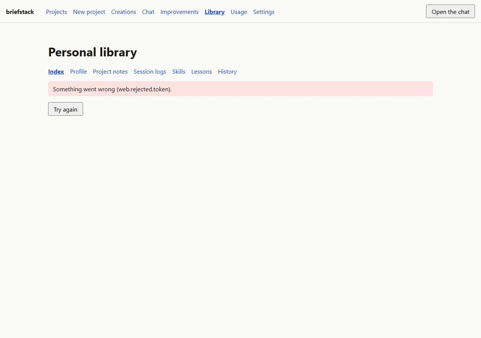 | 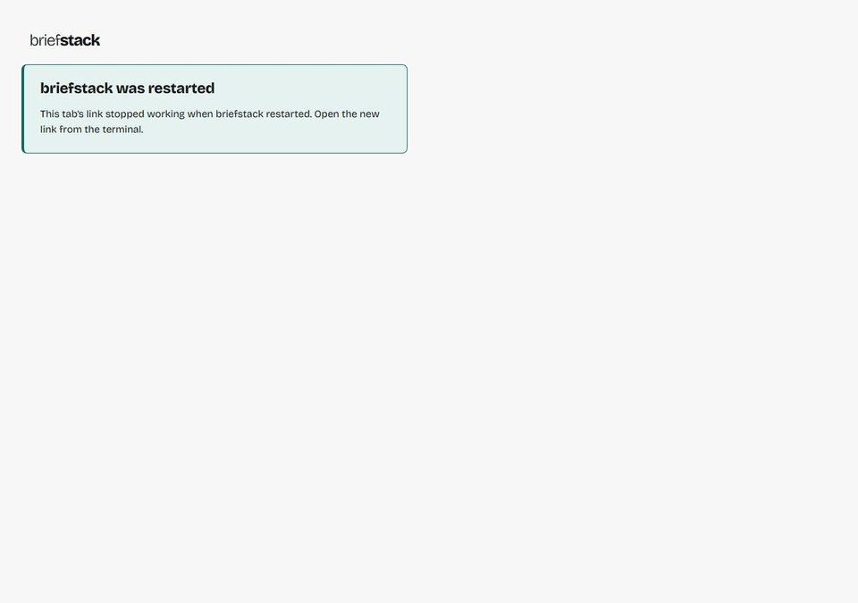 |

## 6. Settings on a phone (390, light)

Every field has its label above it and its hint below, at one height and
16 px text (M5, M6); paths wrap between folders, not inside a name (L6).

| Before | After |
| --- | --- |
| 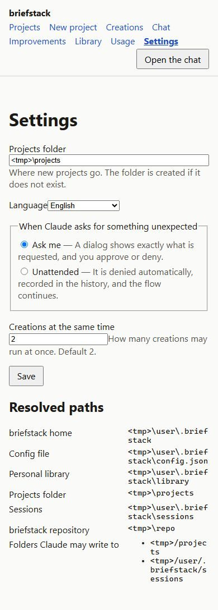 | 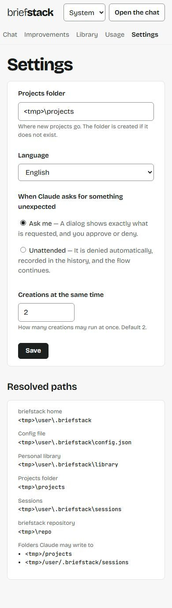 |
